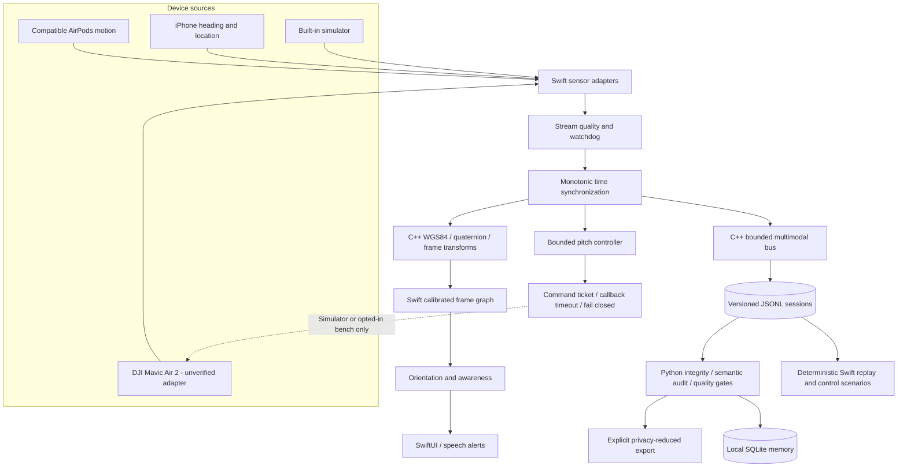

# AeroSpatial

**An extensible spatial intelligence foundation for drones, wearable motion sensing, and human-in-the-loop interaction.**


AeroSpatial provides the **reusable engineering substrate** for a drone interaction system built around compatible AirPods, an iPhone, and a DJI Mavic Air 2. Its fundamental unit is not a camera gesture or a tracking feature. It is a **timestamped spatial observation**, consumed by independent geometry, motion, telemetry, awareness, safety, logging, and replay modules.

The foundation combines three languages deliberately:

- **Swift** runs the iOS application and safety-oriented state machines, adapts hardware inputs, aligns timestamps, manages operator interactions, and defines the portable application-facing APIs.
- **C++17** implements deterministic, platform-neutral numerical primitives behind a stable C interface. Its source builds both through Swift Package Manager and standalone CMake, without DJI dependencies.
- **Python** provides offline log verification, reproducible scenarios, diagnostic metrics, cross-language parity checks, and an opt-in local SQLite spatial observation store.

> **Developer preview / ongoing foundation development.** Core Swift+C++ tests, C++ tests, and Python offline tests have been executed in a Linux environment. The iOS application has passed automated Xcode simulator and DJI-SDK-linked compilation in earlier CI runs; physical-device execution has not been verified. No actual AirPods stream, DJI SDK binary, Mavic Air 2 connection, or aircraft command has been validated here. Real gimbal actuation is **disabled in the standard build**. See [hardware acceptance](Docs/Safety/HARDWARE_TEST_PLAN.md).

## High-throughput multimodal bus

The foundation now ships an in-process **C++17 bounded pub/sub data plane** for
headphone motion, aircraft telemetry, encoded video, perception observations,
and diagnostics. Independent readers observe per-stream monotonic sequence IDs,
source timestamps and clock domains, quality flags, precise missed-event counts,
and explicit overload behavior. C++ subscribers can lease the same native-owned
payload without per-subscriber copies. Swift owns lifecycle/typed app ingress;
Python can audit portable metadata envelopes without loading video payloads.

This is a **tested transport foundation**, not a live DJI video decoder or
flight control mechanism. See [bus engineering contract](Docs/Architecture/MULTIMODAL_BUS.md).


## Algorithm development foundation

The optional-compute layer now includes a bounded **C++ admission governor**, pinhole camera rays and reference-plane geometry, deterministic Swift/Python algorithm dependency manifests, explicit device-capability checks, an offline Python execution harness, causal-span tracing, immutable optical calibration metadata, and synchronized head/video/telemetry metadata bundles.

All optional algorithms are prohibited from publishing head or aircraft telemetry source streams. Neither the compute governor nor the plugin runtime authorizes flight control. Real DJI video, inference and device calibration remain unverified. Read [the algorithm contract](Docs/Architecture/ALGORITHM_PLATFORM.md) and [development matrix](Docs/Development/DEVELOPMENT_TRACKS.md).

```bash
PYTHONPATH=. python3 -m aerospatial_tools algorithms Fixtures/algorithms.json
PYTHONPATH=. python3 -m aerospatial_tools trace-audit Fixtures/traces.jsonl
PYTHONPATH=. python3 -m aerospatial_tools workload --samples 3000 --seed 42
```


## P0 runtime and DJI encoded video

The current developer foundation keeps the C++/Swift/Python core aircraft-agnostic.
DJI **Mavic Air 2** is the initial experimental MSDK V4 adapter; Air 2S and
other products require their own verified adapters. The source now contains an
SDK-conditional encoded H.264 callback receiver, fixed-capacity off-main
transport, and a bounded native Annex-B NAL parser. **NAL units are not decoded
frames**, and capture timestamps, SDK linking and hardware remain unverified.
For portable tests and separate physical acceptance gates, see
[P0 acceptance](Docs/Validation/P0_ACCEPTANCE.md).


## Spatial estimation and metric geometry (P1)

The device-independent mathematical layer includes a C++17 **15-error-state
inertial estimator** (position, velocity, quaternion, sensor biases), SE(3)
exponential/logarithmic maps and covariance propagation, with Swift facades.
Optional Python mapping references add calibrated PnP and epipolar odometry,
parallax-checked triangulation, a fixed-lag out-of-order sensor replay, robust
6-DoF pose graphs, metric-anchored bundle adjustment, bounded sparse landmark
indexing, loop evidence validation, intrinsic calibration, uncertainty analysis
and reproducible motion-model comparison.

These are **portable software components**, not a claimed flight-validated
inertial navigation or live SLAM system. Monocular translation has unknown
scale unless external metric evidence fixes it; raw inertial samples and
real camera calibration have not been verified on Mavic Air 2. See
[math and coordinate contracts](Docs/Architecture/P1_SPATIAL_ESTIMATION.md) and
[the P1 acceptance matrix](Docs/Validation/P1_ACCEPTANCE.md).

```bash
python -m pip install -e '.[mapping]'
PYTHONPATH=. python -m aerospatial_tools spatial-demo --seed 42
```

## P3 offline integration and safe sharing

The latest integration track adds actual CPU ONNX inference of content-verified
trusted models, a decoded-video-to-SQLite visual evidence pipeline, a
fail-closed image-evidence release gate, an optional ROS 2 observation-only
publisher, a device-side Core ML loader interface, and an opt-in privacy-safe
session export in the iOS app. The UI now exposes actual ingress/drop counters
and device thermal state. These are portable/offline integrations, not
live DJI/AirPods SLAM or a verified physical hardware deployment.

See [P3 integration contract](Docs/Development/P3_INTEGRATION.md) and
[P3 acceptance matrix](Docs/Validation/P3_ACCEPTANCE.md).

```sh
PYTHONPATH=. python -m aerospatial_tools video-evidence --help
PYTHONPATH=. python -m aerospatial_tools evidence-gate --help
```

## C++ video and real-time strengthening

The C++ foundation now assembles H.264 **access units** from arbitrarily split DJI SDK Annex-B callback chunks (with IDR resynchronization and SPS/PPS provenance), rather than treating each NAL as a decoded picture. A bounded native deadline/priority work queue separates optional video work from the SwiftUI run loop. iOS CoreMedia/VideoToolbox receives complete AVCC samples and exposes decoded `CVPixelBuffer` to an optional model consumer. Control cadence uses a dedicated monotonic scheduler and measures delivery jitter; the safety state machine remains separately authorized. See [native video and runtime contract](Docs/Development/CPP_VIDEO_RUNTIME.md). None of these portable tests establish real DJI camera timestamps, device decoding performance or airworthiness.

The native video ingestion and optional CPU execution freeze candidate is
reviewed in [Native Freeze Review](Docs/Validation/NATIVE_FREEZE_REVIEW.md), including
explicit remaining hardware acceptance conditions.

## Architecture



Swift owns device control and consent. C++ owns deterministic numerical operations and exposes a C ABI. Python is offline only. The portable core and its simulation tests do not depend on DJI SDK binaries or Apple frameworks.

## Implemented foundation

| Area | Implemented | Verification / boundary |
| --- | --- | --- |
| C++ spatial kernel | Great-circle geodesy, WGS84 ECEF/ENU, quaternion composition/inversion/SLERP, stereo balance, α–β filter | Standalone CMake, Swift FFI and independent Python numerical parity |
| Swift sensor pipeline | Timestamped samples, bounded alignment, wrap-aware interpolation and missing/future/out-of-order/stream-gap diagnostics | Linux Swift unit tests and iOS source integration |
| Head-to-gimbal mapping | Dead zone, explicit calibration, smoothing, rate ceiling, stale-sample interlocks and single-in-flight command tickets | Explicit fail-closed acknowledgment timeout, generation IDs and regression tests; **real output build-gated** |
| Head-relative bearing | Explicit phone/head alignment, compass-quality and time validity gates | 2D stereo-balance **preview only**; not HRTF sound |
| Passive advisor | One-shot link loss, low-battery thresholds, telemetry-age warning | Does not estimate return-to-home safety or issue commands |
| Device capabilities | Separate simulator and conservative unverified DJI profiles | No assumption that a mechanical axis is SDK controllable |
| Versioned event protocol | Bounded v1 contract, validated sequence/fields/notes, monotonic uptime and provenance | Cross-language fixtures, recorder enforcement and legacy compatibility |
| Replay | JSONL parse/integrity report and bounded, seekable virtual timeline | Offline Swift tests and Python validation |
| Synthetic sessions | Seeded Python streams plus a Swift virtual-time runner exercising the real head-pitch controller and command gate | Cross-language valid/invalid replay scenarios |
| Spatial memory | Local SQLite markers, nearby search, idempotent JSONL import | Aircraft camera location only, **not inferred object position** |
| iOS UI | Modular SwiftUI views, stream-quality counters, pending-command state, simulation and optional recording | **Not compiled with Xcode in this environment** |
| DJI MSDK V4 | Experimental telemetry and pitch adapter source, live disconnection delivery and callback interlocks | **Unverified**, requires real SDK, Mac and bench acceptance |
| Calibrated frame graph | Explicit directed/inverse rigid transforms, path resolution, no invented frame relationships | Rotation composition, inverse and graph consistency tests |
| Frame-level perception evidence | Normalized camera-image bounding boxes, confidence and model provenance in a separate SQLite schema | Offline metadata only; **no video ingestion or detector is claimed** |
| Offline quality and privacy | Declarative quality gates, semantic audit rules, seeded corruption injection, SHA-256 manifests and privacy-reduced exports | Python tests and CLI acceptance; the digest is not a digital signature |

### Validated session archive and initial model target

The app now uses bounded, CRC-protected segmented recording as its source of truth,
with a validated JSONL export after recording stops. It can recover an incomplete
final record after restart, but rejects checksum damage or corruption in a prior
segment. The generic core is aircraft-agnostic; the experimental DJI adapter
currently targets **Mavic Air 2**, not **DJI Air 2S**. Device compatibility, video
ingress and gimbal behavior still require real hardware verification. See
[the P0 acceptance document](Docs/Architecture/RUNTIME_FOUNDATION.md).

### Deliberately not claimed

AeroSpatial does **not** currently implement live drone video decoding, visual object recognition, SLAM, HRTF 3D audio, autonomous navigation, aircraft yaw/roll control, or any flight mission. Those require independent hardware and algorithm acceptance gates. Current “head-relative audio” is a calculated **stereo pan / spoken-direction preview**; AirPods head motion is not eye tracking or a true-north heading sensor.

## Repository layout

The repository enforces a maximum of two directory levels for tracked files. See [the layout contract](Docs/SOURCE_LAYOUT.md).

```text
AeroSpatial/
├── Core/              # Swift algorithms, state machines and sensor fusion
├── Kernel/            # C++ numerical kernel, C ABI, CMake and microbenchmarks
├── App/               # iOS services and SwiftUI (at most two levels deep)
├── aerospatial_tools/ # Grouped, installable offline Python modules
├── Tests/             # Swift portable tests
├── NativeTests/       # C++ numerical tests
├── ToolkitTests/      # Offline and cross-language validation
├── Bench/             # Reproducible Swift benchmarking CLI
├── Replay/            # Swift replay CLI
├── Scenario/          # Swift virtual-time scenario CLI
├── Fixtures/          # Stable event schema and sample recording
├── Quality/           # Quality thresholds
├── Docs/              # Detailed design and hardware acceptance
├── Scripts/           # Cross-platform checks
├── .github/workflows/ # Automated Linux, Windows and manual macOS builds
├── Package.swift      # Swift Package Manager using custom shallow paths
├── project.yml        # XcodeGen app definition
└── Podfile            # Opt-in DJI SDK dependency; not redistributed
```

The folders are named by **responsibility**, not programming language. No generated build files or version-numbered source filenames are tracked.

## Run the foundation without an aircraft

**On macOS or Linux, with Swift 5.9+, CMake 3.16+, a C++17 compiler and Python 3.10+:**

```bash
./Scripts/run-checks.sh
```

Alternatively, run each subsystem independently:

```bash
# Swift and the embedded C++ kernel
swift test
swift run aerospatial-replay Fixtures/session.jsonl

# Pure C++ release build
cmake -S Kernel -B build-native -DCMAKE_BUILD_TYPE=Release
cmake --build build-native --parallel
ctest --test-dir build-native --output-on-failure

# Python without any third-party runtime dependencies
PYTHONPATH=. python3 -m unittest discover -s ToolkitTests -v
PYTHONPATH=. python3 -m aerospatial_tools simulate /tmp/sample-flight.jsonl --seconds 30 --seed 7
PYTHONPATH=. python3 -m aerospatial_tools report /tmp/sample-flight.jsonl
PYTHONPATH=. python3 -m aerospatial_tools audit /tmp/sample-flight.jsonl
PYTHONPATH=. python3 -m aerospatial_tools gate /tmp/sample-flight.jsonl \
  --profile Quality/simulator.json
swift run aerospatial-scenario /tmp/swift-loop.jsonl 5 42 2
PYTHONPATH=. python3 -m aerospatial_tools validate /tmp/swift-loop.jsonl
```

For Windows, `Scripts/Run-Checks.ps1` runs the **C++ and Python** suites. The native Swift package is supported on Linux/macOS; compiling the iOS app requires a Mac.

### Local spatial observation memory

```bash
# Data stays in a local SQLite file. No cloud account required.
PYTHONPATH=. python3 -m aerospatial_tools memory add \
  --db local-memory.sqlite3 --lat 40.0 --lon -83.0 \
  --label "Camera observation point"

PYTHONPATH=. python3 -m aerospatial_tools memory nearby \
  --db local-memory.sqlite3 --lat 40.0 --lon -83.0 --radius 200

PYTHONPATH=. python3 -m aerospatial_tools memory import \
  --db local-memory.sqlite3 --session Fixtures/session.jsonl
```

Import is idempotent for versioned `spatial_marker` events. The marker represents the **aircraft GPS location at the time of the operator action**, not the distant subject in the camera view. Explicit landmark geolocation will require camera calibration, ranging, geometry and uncertainty estimates in a future module.

### Privacy-reduced export and fault regression

```bash
# Sharing is explicit. Original GPS-bearing session is never overwritten.
PYTHONPATH=. python3 -m aerospatial_tools sanitize /tmp/sample-flight.jsonl /tmp/share.jsonl
PYTHONPATH=. python3 -m aerospatial_tools digest create /tmp/share.jsonl /tmp/share.sha256.json
PYTHONPATH=. python3 -m aerospatial_tools digest verify /tmp/share.jsonl /tmp/share.sha256.json

# Test that integrity and quality checks reject damaged traces.
PYTHONPATH=. python3 -m aerospatial_tools inject-fault \
  /tmp/sample-flight.jsonl /tmp/stale-head.jsonl --fault stale_head
PYTHONPATH=. python3 -m aerospatial_tools audit /tmp/stale-head.jsonl
```

The sanitization pass strips recognized GPS-coordinate keys, notes, identifying session IDs and original wall times. It **cannot guarantee** that custom numeric fields are non-identifying. Inspect any exported data before publishing. See [data governance](Docs/Safety/DATA_GOVERNANCE.md).

### A typed foundation for future computer vision

The optional Python `PerceptionStore` records validated `FrameObservation` metadata: model ID, session/frame reference, capture uptime, normalized image bounding box and a bounded confidence score. This **does not run object detection** and does **not claim a target's geographic position**. It is an extension point for a future on-device or offline perception pipeline.

```python
from pathlib import Path
from aerospatial_tools.perception_models import FrameObservation, ImageBox
from aerospatial_tools.perception_store import PerceptionStore

frame = FrameObservation.create("session-001", "frame-1", 100.0, "example-model",
                                "vehicle", 0.92, ImageBox(0.1, 0.2, 0.3, 0.4))
with PerceptionStore(Path("observations.sqlite3")) as store:
    store.add(frame)
    print(store.by_session("session-001"))
```

## iOS app / simulation

1. On **macOS**, install Xcode 15+ and [XcodeGen](https://github.com/yonaskolb/XcodeGen), then run `xcodegen generate` in the repository root.
2. Open `AeroSpatial.xcodeproj`, choose a signing team and set your own bundle identifier.
3. Build the app in **Simulation** mode on the iOS simulator or physical iPhone. This mode does not need DJI SDK or credentials.
4. Use the demo head sliders, calibrate, and enable simulated pitch assistance. To export JSONL, enable recording before interacting.
5. On a physical iPhone, optional supported AirPods head motion and phone location/heading can be tried separately, subject to device permission and compatibility.

### DJI adapter: experimental, off by default

DJI Mavic Air 2 is a DJI Mobile SDK V4 family device, but current iOS/Xcode/firmware compatibility is **not independently established** by these source files. To try linking it, provide your own DJI developer App Key and CocoaPods dependencies and open the generated `.xcworkspace`. **The normal build never transmits gimbal pitch commands**. A dedicated compile-time flag `AEROSPATIAL_EXPERIMENTAL_BENCH` is reserved for a supervised **propeller-removed, nonflying** hardware bench experiment and must not be enabled in a shipping build. Follow every gate in [the hardware plan](Docs/Safety/HARDWARE_TEST_PLAN.md). Do not use the bench build in flight.

The included `DJIAdapter.swift` is unverified integration code, not a certification that an Mavic Air 2 firmware version permits all camera axes or accepts the current SDK signatures. Aircraft flight commands are absent.

## Engineering rules

- **Fail closed:** unauthorized, disconnected, uncalibrated, stale or malformed motion produces no new camera command.
- **Data provenance:** simulator output is never labeled physical telemetry. Heading must be true-north and of known quality before creating head/world alignment.
- **Portable computation:** numeric algorithms have explicit units and a stable C ABI. Swift owns real-time state and adapters; Python is offline.
- **Reproducible testing:** record a session, validate it, seek it with `ReplayCursor`, and compare results against fixed scenarios.
- **Local-only by default:** raw recordings can contain sensitive GPS coordinates and must not be committed or shared without review. The foundation includes an explicit privacy-reduced export; neither flight audio nor onboard video is uploaded by the tools.
- **Small files / narrow responsibilities:** new modules should normally stay under ~200 source lines, with separate tests for geometry, timing, controls, diagnostics and storage.

See [architecture](Docs/Architecture/ARCHITECTURE.md), [extension interfaces](Docs/Development/EXTENDING.md), [coordinate frames](Docs/Architecture/SPATIAL_FRAMES.md), [command safety](Docs/Safety/COMMAND_SAFETY.md), [quality gates](Docs/Safety/QUALITY_GATES.md), [data governance](Docs/Safety/DATA_GOVERNANCE.md), [event protocol](Docs/Architecture/EVENT_PROTOCOL.md), [test matrix](Docs/Reports/TEST_MATRIX.md) and [roadmap](Docs/Development/ROADMAP.md).

## Independent project

AeroSpatial is an independent open-source research/development foundation and is not affiliated with or endorsed by Apple or DJI. Apple SDKs and DJI's Mobile SDK are provided under their separate terms, and the DJI binary SDK is **not bundled** in this repository.

Original project code is MIT-licensed. See [LICENSE](LICENSE).

## Performance-oriented foundation

AeroSpatial separates **fast, deterministic computation** from device callbacks and offline experimentation.

- `TimestampRing` is a bounded, preallocated ring. Appends do not shift memory (`O(1)`); timestamp lookup uses binary search (`O(log N)`). It replaces the earlier front-removal and linear scanning implementation.
- `NativeBatch` binds C++ allocation-free WGS84 and low-pass array kernels to Swift; invalid inputs are rejected before the output is modified.
- `StreamGovernor` controls **only** telemetry visualization or analytics publishing rate, with backoff under load. It must never gate safety checks or control admission.
- `ClockBridge` estimates bounded remote-to-local clock drift for observation alignment with explicit outlier rejection. It does not certify synchronized clocks or authorize a hardware command.
- The offline toolkit offers an event-aware sampler and constant-memory online moments. Important observations can bypass downsampling.

Run repeatable microbenchmarks (hardware dependent, not a flight latency guarantee):

```bash
swift run -c release aerospatial-bench 100000
cmake -S Kernel -B build-native -DCMAKE_BUILD_TYPE=Release -DAEROSPATIAL_BUILD_BENCHMARKS=ON
cmake --build build-native --parallel
./build-native/aerospatial-bench 500000
PYTHONPATH=. python3 -m aerospatial_tools benchmark --count 100000 --iterations 5
```

See [performance contract and measurement methodology](Docs/Development/PERFORMANCE.md).

## Foundation reliability audit

The native bus now supports a global payload budget (including lease-held data),
cached publisher handles, explicit shutdown semantics, and concurrent budget
regression tests. The metadata-only Swift timeline enforces explicit clock
normalization with uncertainty-aware alignment. Offline stream audits distinguish
initial subscriber gaps from later transport gaps. See
[Engineering audit](Docs/Validation/ENGINEERING_AUDIT.md) for resolved and outstanding risks.

UI source files live directly under `App/`. Native public headers remain under
`Kernel/include/` because Swift Package Manager requires that public header path.
The Python package remains under `aerospatial_tools/` for importability.
Neither the bus nor the timeline issues flight commands. Hardware validation is pending.

## Durable streams and cross-language diagnostics

The C++ kernel provides an in-process, bounded event bus with leased fan-out, memory quotas,
backpressure, strict stream sequencing and fast cached publisher handles. New optional
transport utilities add a 44-byte CRC-checked head-motion record and a bounded
segmented append-only journal, both accessible from Swift and Python tooling.

`Core/Video/VideoIngress.swift` validates a caller-provided **encoded** video frame's size,
codec, clock domain and capture timestamp before publishing. It does **not** decode
DJI video or establish a live video source. Frame observations can be associated
with trusted video evidence within explicit time uncertainty, but no automatic
geolocation of visual targets is claimed.

See [all 20 acceptance items](Docs/Validation/INTEGRATION_ACCEPTANCE.md) and
[wire/storage contracts](Docs/Safety/STORAGE_PROTOCOL.md). Physical hardware and full
Xcode/iOS integration gates remain open and must be verified before any aircraft use.

## Numerical foundation and offline vision

The portable C++ kernel includes Theil–Sen/least-squares clock calibration,
Brown–Conrady distortion inversion, and a constant-velocity Kalman estimator
with normalized innovation gating. Swift wraps the same C ABI. Optional offline
Python tools add OpenCV video decode, ORB + RANSAC image-level place matching,
trusted subprocess algorithm execution and AES-256-GCM authorized export.
These algorithms do **not** infer precise GPS positions or control flight.

```bash
# Optional capabilities (not needed for the portable core)
python -m pip install -e '.[vision,privacy]'
PYTHONPATH=. python -m aerospatial_tools video-probe path/to/local-video.mp4
PYTHONPATH=. python -m aerospatial_tools vision-match reference.jpg revisit.jpg
```

See [Mathematical foundation](Docs/Architecture/MATHEMATICAL_FOUNDATION.md) and
[acceptance review](Docs/Validation/ACCEPTANCE_REVIEW.md).

## Portable runtime hardening

The observation-only P0 building blocks add a bounded real-time mailbox, native atomic latency histogram, uncertainty-aware clock registry, device-evidence expiration, fail-closed safety assessment, encoded-frame routing, and asynchronous CRC-framed journal writes. See [runtime acceptance and remaining hardware gates](Docs/Architecture/RUNTIME_FOUNDATION.md). These are portable components, **not** a claim of completed DJI/iPhone hardware integration.

The application now forwards head and telemetry publications through `SpatialIngressPublisher` on a utility worker and writes its legacy JSONL sessions through a bounded asynchronous writer. This does not constitute a complete VideoToolbox/DJI hardware integration or a finished segment-journal UI migration.

## P2 developer and spatial-intelligence extensions

The next portable layer adds a **native optional-compute quality governor**,
short-horizon head-look previews, time-scoped frame calibration, typed Swift
model declarations, verified offline model artifacts, reproducible experiment
reports, deterministic receive-side fault simulation, SQLite spatial evidence,
conservative derived-log retention and ROS2-compatible pose serialization.

These are reusable implementation components, not a claim that Mavic Air 2
hardware, live Core ML execution, ROS2 networking, georeferencing or flight
safety has been certified. See [P2 architecture](Docs/Development/P2_PLATFORM.md) and
[P2 acceptance](Docs/Validation/P2_ACCEPTANCE.md) for the precise boundaries and test gates.
